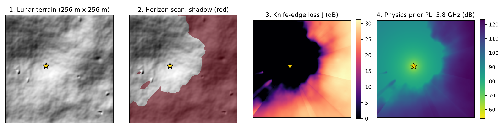

# RayNet: ray-aligned neural radio maps for the Moon

RayNet predicts where a radio transmitter's signal reaches on cratered lunar terrain, as a
pathloss map in dB, in milliseconds instead of a slow ray-tracing run.

It looks at the terrain from the transmitter's point of view. It maps the area to polar
coordinates around the transmitter, scans each ray for the highest obstacle (the horizon), and
learns a correction on top of a simple physics estimate.

> **Status:** work in progress. Course project for EHB420E Artificial Neural Networks,
> Istanbul Technical University, Fall 2026.



## Demo
Coming soon: pick a terrain, click to place a transmitter, and see the coverage map. The model
runs in your browser with ONNX Runtime Web. A preview page is in `web/prototype/`.

## Results (frozen validation split)
| Model | 415 MHz RMSE (dB) | 5.8 GHz RMSE (dB) | Combined |
|---|---|---|---|
| RadioUNet (same budget) | TBD | TBD | TBD |
| Physics prior | TBD | TBD | TBD |
| RayNet | TBD | TBD | TBD |

## How it works
1. **Physics prior:** free-space pathloss plus a knife-edge term from the strongest obstacle.
2. **Polar view and horizon scan:** each ray from the transmitter becomes one row; a running
   maximum of the elevation angle tells which points are in shadow.
3. **Learned residual:** a U-Net adds a correction to the prior. Loss: masked MSE on valid pixels.

## Quick start
```bash
pip install -e ".[dev]"
pytest -q
python -m raynet.train --config configs/e4_raynet_58.yaml --data-root <data>
python -m raynet.evaluate --run runs/E4_58_s0 --split val --data-root <data>
```
Details: `docs/` (start with `docs/00_PROJECT_BRIEF.md`).

## Data
First Lunar Pathloss Radio Map Prediction Challenge dataset (Pearson, Torrado, Yapar, Smith),
from RadioLunaDiff (Torrado et al., ICASSP 2026), licensed CC BY 4.0, available on Kaggle.
Demo terrains are generated with LunarTerrainGenerator (MIT).

## Acknowledgements and licences
- Code: MIT License.
- Dataset: CC BY 4.0. Please cite RadioLunaDiff when you use it.
- Baseline: RadioUNet (Levie et al., IEEE TWC 2021), MIT; official challenge code, MIT.
- AI use: developed with Claude (Anthropic) as a research and coding assistant. The design,
  experiments and analysis are by the author. All results come from the author's own runs.
