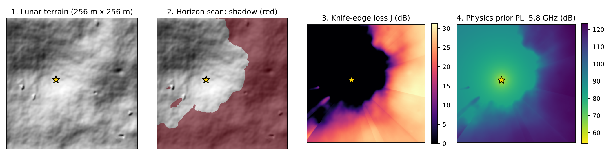

# 02 · Physics features (prior, polar view, horizon scan)

A verified prototype of everything in this file is in `docs/reference/physics_prototype.py`.
Re-implement it cleanly in `src/raynet/physics.py`, keep the same conventions, and add the tests
in section 9.

*Generated terrain, TX = yellow star. Left to right: terrain, shadow from the horizon scan,
knife-edge term J, physics prior at 5.8 GHz. Made with the prototype.*

## 1. Conventions
- Grid: 256 × 256, 1 m per pixel. Position of pixel (row i, col j) is (y = i, x = j) metres.
- TX at pixel `(tx_row, tx_col)`. TX antenna height `z_tx = H(tx) + 3.0` m.
- RX at every pixel: `z_rx(i, j) = H(i, j) + 1.0` m. H = heightmap in metres.
- Horizontal distance `r = sqrt((i - tx_row)^2 + (j - tx_col)^2)`.
- 3D distance `d = sqrt(r^2 + (z_rx - z_tx)^2)`, clamped to at least 1 m.
- Moon curvature is ignored: over 362 m the drop is about 1 cm (d² / 8R).
- Frequencies: `f_415 = 415e6` Hz, `f_58 = 5.775e9` Hz. Wavelength `λ = c / f`, c = 299 792 458 m/s
  (λ_415 = 0.7224 m, λ_58 = 0.05191 m).

## 2. Free-space pathloss
`FSPL_dB = 20·log10(d) + 20·log10(f) − 147.55` (d in m, f in Hz; 147.55 = −20·log10(4π/c)).

## 3. Knife-edge term (ITU-R P.526)
- Fresnel-Kirchhoff parameter: `ν = h · sqrt( 2 (d1 + d2) / (λ d1 d2) )`
  - h: height of the edge above the straight TX→RX line (negative = clearance), d1: TX→edge
    distance, d2: edge→RX distance (horizontal, both clamped to ≥ 1 m).
- Loss: `J(ν) = 6.9 + 20·log10( sqrt((ν − 0.1)^2 + 1) + ν − 0.1 )` for ν > −0.78, else 0 dB.
- Which edge? We use one dominant edge per (ray, radius): the **TX-horizon point**, the terrain
  sample with the highest elevation angle between the TX and this radius. The horizon scan
  gives its index for free (section 5). This is a simple approximation; Deygout (several edges)
  is an optional extension.
- **Important:** the dataset ray tracer has diffraction disabled. So J is used as a geometric
  "how deep in shadow" feature. The real shadow loss in the data is usually larger.

## 4. Polar grid (transmitter-centred)
- T rays, R radial samples: `θ_t = 2π t / T`, `r_k = (k + 1)·Δr`.
- Sample point of (t, k): `y = tx_row + r_k sin θ_t`, `x = tx_col + r_k cos θ_t`.
- Sample with `F.grid_sample(height, grid, mode="bilinear", padding_mode="border", align_corners=True)`.
  Normalized coordinates: `x_n = x / (W − 1)·2 − 1`, `y_n = y / (H − 1)·2 − 1`.
  **grid_sample wants (x, y) order in the last dimension.**
- Points outside the tile: also return an `inside` mask (0 outside), useful as an input channel.
- Default for physics features: **T = 720, Δr = 1.0 m, R = 363** (covers the 362 m diagonal).
  Measured line-of-sight agreement with brute-force line tracing on generated terrains:

| T | Δr (m) | R | mean agreement | worst case |
|---|---|---|---|---|
| 360 | 1.42 | 256 | 99.5% | 99.2% |
| 512 | 1.42 | 256 | 99.4% | 98.7% |
| 720 | 1.0 | 363 | 99.7% | 99.3% |
| 1440 | 1.0 | 363 | 99.8% | 99.7% |

- The network's polar branch (docs/03_MODEL.md) may use its own coarser grid (for example
  T = 360, R = 256). It is learned, so small interpolation errors matter less.

## 5. Horizon scan
For each ray (row of the polar grid):
1. Terrain elevation angle seen from the TX antenna: `α_k = atan2(H(r_k) − z_tx, r_k)`.
2. Horizon before sample k: `A_k = max(α_0 … α_{k−1})` and its index `m_k` (exclusive running max).
3. Receiver elevation angle: `β_k = atan2(H(r_k) + 1 − z_tx, r_k)`.
4. `LoS_k = 1 if β_k ≥ A_k else 0`. `shadow_k = max(0, A_k − β_k)` in radians.
5. Edge for the knife-edge term: `d1 = r_{m_k}`, `d2 = r_k − r_{m_k}`,
   `h = H(r_{m_k}) − [ z_tx + (z_rx,k − z_tx)·r_{m_k} / r_k ]`. For k = 0 there is no edge: ν = −10.

**ONNX rule:** `torch.cummax` cannot be exported to ONNX (tested with torch 2.15, both
exporters fail). Use `scan_max_exclusive` from the prototype. It is a Hillis-Steele scan with
log2(R) "shift and compare" steps. It is tested equal to cummax (values and indices).
`torch.cummax` is fine in training-only analysis code.

## 6. Back to the Cartesian grid
- For each pixel compute its `(r, θ)` (θ in [0, 2π)). Polar index: `k = r/Δr − 1`, `t = θ/2π·T`.
- Append the first ray at the end of the θ axis (wrap-around), then use `grid_sample` with
  `align_corners=True` on the polar maps.
- LoS on the Cartesian grid: interpolated LoS ≥ 0.5.

## 7. The prior
- `PL_prior = FSPL(d) + J(ν)`. This is experiment **E1**.
- **E1b, calibrated prior:** per band, fit a linear model on dev-split valid pixels:
  `PL ≈ a0 + a1·FSPL + a2·J + a3·LoS + a4·shadow_deg` (least squares, 5 numbers per band,
  save them to `results/e1b_coeffs.json`). Because diffraction is off in the data, we expect
  a3 and a4 to add a lot of loss in shadow. E3 and E4 add their residual to the E1b prior.

## 8. Input channels for the networks (E2, E3, E4)
Compute on the GPU inside the model wrapper, after augmentation (so TX coordinates match).
| # | Channel | Scaling |
|---|---|---|
| 1 | height | (H − hm_min)/(hm_max − hm_min) from metadata.json |
| 2 | TX one-hot | 0/1 |
| 3 | log distance | log10(max(d,1)) / log10(363) |
| 4 | FSPL | (FSPL − pl_min)/(pl_max − pl_min) |
| 5 | LoS | 0/1 |
| 6 | shadow | clip(shadow_deg / 10, 0, 3) |
| 7 | ν | clip(ν, −5, 5) / 5 |
| 8 | J | J / 40 |
| 9 | prior (E1b) | (prior − pl_min)/(pl_max − pl_min) |
Keep this table and the code in sync. The ONNX model must compute the same channels.

## 9. Tests (pytest, `tests/test_physics.py`)
Test vectors are in `docs/reference/test_vectors.json` (load it in the test).
1. FSPL vectors within 0.01 dB. Examples: d = 100 m → 64.811 dB (415 MHz), 87.681 dB (5.775 GHz).
2. Knife-edge vectors within 0.01 dB: J(0) = 6.033, J(1) = 13.926, J(−0.5) = 1.959, J(−1) = 0.
   ν example: h = 2 m, d1 = 50 m, d2 = 100 m at 5.775 GHz → ν = 2.1502, J = 19.632 dB.
3. `scan_max_exclusive` equals exclusive `torch.cummax` (values and indices) for random
   tensors with R = 256 and R = 363.
4. Flat terrain: LoS everywhere, J = 0, prior = FSPL.
5. Wall: flat terrain with a 10 m wall at columns 150-152, TX at (128, 100): pixel (128, 200)
   is NLOS with J > 20 dB; pixel (128, 130) is LoS. (Prototype: J = 32.8 dB there.)
6. LoS vs brute force (`los_bruteforce` in the prototype) on 20 random (terrain, TX) cases:
   mean agreement ≥ 99.0%, worst ≥ 98.5% (T = 720, Δr = 1.0). Terrains: data subset or
   generated terrains.
7. Rotation: rotate height and TX by 90°; LoS map rotates with it (agreement ≥ 99%).
8. ONNX parity: export a wrapper `(height, tx, band) → prior`, run with onnxruntime,
   max difference ≤ 0.01 dB.

## 10. Speed (prototype, CPU)
Batch of 8 tiles: 0.16 s on a 2-core cloud CPU. On GPU it is a few milliseconds, so compute the
features on the fly during training (no caching needed).
